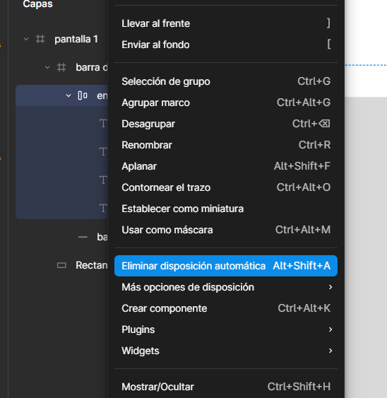
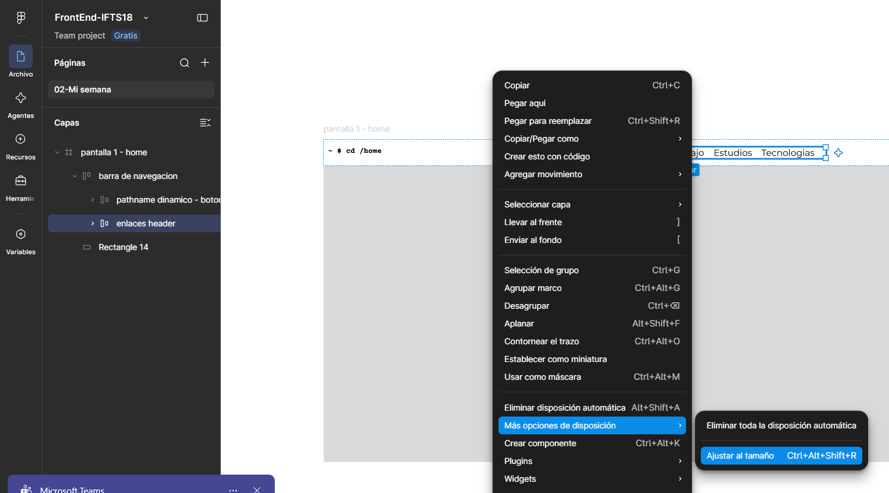

# Sass
- https://www-freecodecamp-org.translate.goog/news/the-beginners-guide-to-sass/?_x_tr_sl=en&_x_tr_tl=es&_x_tr_hl=es&_x_tr_pto=tc 
- https://www.youtube.com/watch?v=A1tyKkkziTc&t=976s
- https://es.stackoverflow.com/questions/150935/c%C3%B3mo-compilar-varios-scss-en-un-solo-archivo-css-gulp-y-nodejs
- https://dev-to.translate.goog/sarah_chima/using-sass-partials-7mh?_x_tr_sl=en&_x_tr_tl=es&_x_tr_hl=es&_x_tr_pto=tc
- https://github.com/nolimits4web/swiper/issues/7771

# Js
- https://developer.mozilla.org/es/docs/Web/API/Fetch_API/Using_Fetch
- Pathname - https://developer-mozilla-org.translate.goog/en-US/docs/Web/API/URL/pathname?_x_tr_sl=en&_x_tr_tl=es&_x_tr_hl=es&_x_tr_pto=tc
# Imports / JS
- https://lenguajejs.com/javascript/modulos/alias-import/

# HTML / JS Dinámico
- https://www-freecodecamp-org.translate.goog/news/reusable-html-components-how-to-reuse-a-header-and-footer-on-a-website/?_x_tr_sl=en&_x_tr_tl=es&_x_tr_hl=es&_x_tr_pto=tc

# Figma
- Click derecho: Agregar disposición automática

- Click derecho > Más opciones de disposicion > Ajustar al tamaño

# Accesibilidad
- https://webaim.org/resources/contrastchecker/?fcolor=FFFFFF&bcolor=2300EB